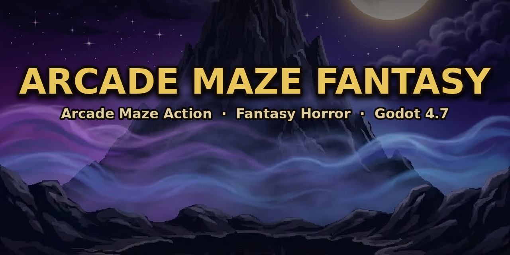

<p align="center">
  
</p>

<h1 align="center">Arcade Maze Fantasy</h1>

<p align="center">
  <a href="https://godotengine.org"></a>
  
  
  
  
</p>

<p align="center"><em>Versione italiana: <a href="README.md">README.md</a></em></p>

---

**Arcade Maze Fantasy** is a fantasy/horror arcade maze action game: explore haunted procedural mazes, collect treasures and magic relics, survive the ghost onslaught, duel 17 unique bosses and level up along the way, spending score points on 8 skills. Born as a C++/SFML prototype, it has been fully ported to **Godot 4.7.2 / GDScript** with real-time synthesized audio, a fully localized IT/EN interface and zero audio files in the project.

## Table of Contents

- [Features](#features)
- [Gameplay](#gameplay)
- [Controls](#controls)
- [Requirements and Launch](#requirements-and-launch)
- [Project Structure](#project-structure)
- [Technical Architecture](#technical-architecture)
- [Quality and Testing](#quality-and-testing)
- [Development Branches](#development-branches)
- [License](#license)

## Features

- **68 story levels** organized in 17 cycles: 3 maze levels + 1 boss room each.
- **Procedural mazes** (30×15 cells) generated every run, with arcade-style wrap-around edge tunnels.
- **17 unique bosses**, each with its own room, attack pattern and themed projectiles; **51 mini-boss types** and **44 enemy types**.
- **Maze hazards**: **sheet ghosts** (white, red, green) cross the walls and respawn all level long in waves that thicken as you progress — they drain 33% of your energy on touch and can be dodged by jumping; **zombie cells** hide arms reaching out of the wall gratings: unavoidable damage, wait for the retraction or pay the touch.
- **Environmental hazards**: seven perils generated in every maze — **quicksand** cells that slow you down 50% (jump across), **jaw traps** that snap once per level (a projectile springs them harmlessly), **chasms** announced by a blinking crack and then open for the rest of the level (falling costs a life), **rock walls** cycling open and closed, **explosive barrels** with chain reactions, **pixel-art blade wheels** skating wall-to-wall down the corridors (from level 10, jumpable) and **spear blocks** rising from the floor after a vibrating warning (from level 12, heavy unavoidable damage — wait them out).
- **Relic system**: 18 relics collected in post-boss bonus screens — 6 melee weapons, 6 ranged weapons, 6 armors with special effects (projectile reflection, thorns, regeneration, damaging auras…) — plus **elemental weapons per archetype** (flame, frost, arcane) with a dedicated muzzle flash per weapon and element.
- **Level Up system**: the score doubles as experience — every threshold crossed grants a bankable skill point to spend in pause on **8 upgrades** (vital energy, stamina, extra mid-air jump, firepower, magazine, swiftness, luck, regeneration); announcement with a white-gold pixel-art lightning bolt, golden lettering and a dedicated jingle, progress kept across continues and reset only on a new game.
- **New Game Plus / Plus Plus**: after the endgame credits a bonus-weapon-style card asks — “Do you want to keep playing (new game plus)? You will restart from the first level of the game without losing your accumulated upgrades, at a higher difficulty.” — with **YES** / **NO (Return to the Main Menu)** options. Accepting restarts from level 1 while keeping the Level Up level, points and skills: enemies, mini-bosses and bosses deal **+20% damage** and have **+33% resistance** (NG+); finishing NG+ unlocks **NG++** (**+40% / +50%**, the cap). Score, lives, relics and weapons start fresh, the scoring economy stays at base values and the HUD shows a golden tier badge.
- **Dungeon atmosphere**: torches casting warm flickering light pools on the floor, a lantern following the hero, generated gothic props (altars, coffins, gargoyles, cobwebs…), dark per-level palettes.
- **Local 2-player co-op**: friendly fire enabled, soul transfer between players and separate continue credits.
- **100% procedural audio**: 59 sound effects and 9 music tracks synthesized at runtime, with no audio files in the project — picking up the invincibility chalice fires a four-phase epic power effect (charge, impact, brass fanfare, sparkle). Synthesis runs in a background thread: startup in ~2.5 seconds.
- **AI pixel-art graphics** (PixelLab pipeline) with high-definition sprite sets (256px frames), per-sheet facing metadata for consistent marching direction, procedural boss limb animation via mesh deformation, **per-type death animations for bosses and the player** (hell portals opening in the floor, family-tinted rune seals, the hero's collapse), **lives shown as hearts that crumble hit after hit** and a medieval-gold gothic interface (Goth And Gothic font).
- **Full IT/EN localization**: menus, HUD, overlays and per-language logos, selectable from `OPTIONS → LANGUAGE` and persisted in the configuration.
- **Classic arcade systems**: persistent top-10 Hall of Fame, countdown continues, an extra life every 50,000 points, rewards calibrated on target toughness (enemy < mini-boss < boss), attract demo mode with BFS pathfinding AI after 30 s of menu inactivity, "Hurry Up!" with an immortal chaser.
- **Full joystick support** with in-menu button remapping.

## Gameplay

The game loop alternates **maze exploration** and **boss duels**:

1. **In the maze** collect the 8 treasures to open the exit door; find weapons, ammo and 9 collectibles per level (immortality chalice, ghost potion that walks through walls, lightning scepter, speed boots, medkit, ally statues…). Watch out for sheet ghosts, zombie cells and the seven floor hazards: chasms yawn open, blades skate the corridors, spears rise without mercy. At 50% of enemies cleared, a portal opens respawning enemies and a mini-boss.
2. **In the boss room** combat is free-form pixel movement: dodge the boss's themed projectiles, use the weapons dropping on the ground (they regenerate while the boss lives), the dedicated siege cannon and the bouncing mine that removes 30% of the boss's health.
3. **After each boss** (except the final level) pick a relic in the forge bonus screen: one per family, with a rotation designed to collect them all over a full playthrough.

Depth mechanics: stamina limiting jumps to 2 in a row (extendable through skills up to an extra mid-air jump), progressive enemy respawn in advanced levels, temporary chalice invincibility with an epic sound effect, ghost mode from the potion, enemies targeting the nearest living player in 2P, ghost waves growing denser as levels climb.

### Progression and Level Up

The score does double duty: beyond the leaderboard it is **experience**. The cumulative threshold for level n is 1,000 × n^1.75 (rounded to 50): level 2 lands within the first maze (3,350 points), level 10 at half a run (56,250) and level 20 is the practical ceiling (189,150). Every threshold crossed fires the announcement — a white-gold pixel-art lightning bolt, golden lettering and a jingle — and grants a **bankable skill point**: spend nothing in the modal and the point stays banked, stacking with the next level up.

| Skill | Effect per level | Cap |
|---|---|---|
| Vital Energy | +5% max energy | 10 |
| Stamina | +7% max stamina, faster recharge | 10 |
| Extra Jump | +1 mid-air jump (requires Stamina 4) | 2 |
| Firepower | +5% damage per hit | 10 |
| Extended Magazine | +1 shot per magazine | 8 |
| Swiftness | +4% movement speed | 8 |
| Hunter's Luck | +3% enemy drop chance | 6 |
| Regeneration | +0.2 energy every 5 s out of combat | 4 |

The modal opens in pause after the announcement: bilingual rows with pixel-art icons, +/− buttons and a hold-to-confirm OK. In 2P the two players pick in sequence with their own controls; progress survives continues and resets only on a new game.

## Controls

| Action | Player 1 | Player 2 |
|---|---|---|
| Movement | Arrow keys | W A S D |
| Jump (double with stamina) | Space | Q |
| Shoot | Z | E |
| Pause | P | — |
| Menu confirm | Enter / Space | — |

**Joystick**: movement on analog stick and D-pad; jump/shoot buttons are configurable from the `OPTIONS` menu (separate mapping for P1 and P2, saved to `config.ini`).

## Requirements and Launch

- [Godot 4.7.2](https://godotengine.org/download) (exactly this version: the project uses 4.7 branch features)
- No additional dependencies: assets and audio are generated by the project itself

```bash
# Launch from the editor
#   open godot/project.godot and press F5

# Launch from terminal
godot --path godot

# Headless check (no window)
godot --headless --quit --path godot
```

For executable exports use the Godot 4.7.2 export templates (GL Compatibility renderer: compatible with older hardware and WebGL). Cross-platform build procedures (Windows, Linux, macOS) are documented in [BUILD_WINDOWS.md](BUILD_WINDOWS.md).

## Project Structure

```
godot/                       # Godot project (open this one)
├── project.godot            # autoloads, input map, window settings
├── scripts/
│   ├── core/                # MainGameController, Player, Maze, BFS,
│   │                        #   GameConstants, I18nManager, DemoController…
│   ├── bosses/              # Boss, MiniBoss
│   ├── enemies/             # Enemy, EnemySpawner (progressive respawn)
│   ├── entities/            # GhostReaper, KnightAlly, MazeGhosts,
│   │                        #   ZombieCells, MazeHazards (floor
│   │                        #   hazards), BossDeathSequences (boss
│   │                        #   deaths), effects (soul, lightning)
│   ├── items/               # Weapon, Projectile, Collectibles, Hammer
│   ├── audio/               # AudioManager (full procedural synthesis)
│   └── ui/                  # Hearts HUD, menus, screens, LevelUp,
│                            #   BonusScreen, ContinuesOverlay
├── scenes/                  # 13 .tscn scenes
├── shaders/                 # 11 shaders (enhancement, armor outfits, boss deform…)
├── assets/                  # sprites (SD + XHD + env), backgrounds, fonts
└── tests/                   # 56 headless runtime tests + 81 screenshot harnesses
src/                         # Legacy C++/SFML prototype (reference only)
scripts/                     # Python asset generators (sprites)
tools/bestiary/              # Bestiary generators
docs/                        # Repository banner and materials
```

## Technical Architecture

- **Autoloads** (10, load order): `LoadingScreen`, `BootManager`, `GameManager`, `SpriteManager`, `ConfigManager`, `I18n`, `AudioManager`, `EffectsManager`, `EnvironmentArt`, `CharacterArt`.
- **MainGameController** drives the maze loop: input, pickups, portal, "Hurry Up!", friendly fire, relic sweeps, progressive respawn, per-player continues and the maze perils (`MazeGhosts`, `ZombieCells`, `MazeHazards`).
- **BossRoomController** drives the duel: homing projectiles, weapon regeneration, siege cannon, anti-softlock, post-boss bonus phase with the fight frozen and **per-type boss deaths** via `BossDeathSequences` (PixelLab portals opening in the floor, vortices, family-tinted rune seals).
- **Player** is dual-mode: grid-locked movement in the maze, free movement in the boss room; full relic and elemental weapon state, jump stamina, ghost mode, facing consistent with the marching direction, per-weapon muzzle flash, animated death collapse and stats boosted by Level Up skills.
- **I18nManager** (`I18n` autoload): IT/EN localization with dictionaries, a language-change signal and per-language logos.
- **AudioManager**: 3215 lines of pure GDScript synthesis — oscillators, noise, circular-tap reverbs for seamless loops, voice pool with debounce; synthesis happens in a prioritized background thread (menu → SFX → music) for fast startup.
- **LevelUpAnnounce / LevelUpOverlay** (pure CanvasLayers, BonusScreen pattern): non-blocking level-up announcement (bolt + lettering + jingle) and the 8-skill modal with bankable points, hold-to-confirm and separate P1/P2 input.
- **Maze** procedural rendering (per-level palettes, calibrated wall luminance, torches and lanterns) and `DeformableSprite`: 2D mesh with per-boss-type limb animation profiles and shader-based canvas enhancement.
- Constants and balancing are centralized in **GameConstants.gd** (alias `C`), with static rollback flags for every graphics feature (lanterns, ghosts, zombie cells, XHD…).
- **Performance**: cached effect materials and textures, no per-frame GPU→CPU readback, a cap on simultaneous FX, lazily loaded sprites.

## Quality and Testing

The project ships a **headless runtime test suite of 56 tests** plus **81 screenshot harnesses** for visual QA, running without a window:

```bash
# Example: run one test
godot --headless --path godot res://tests/test_stamina_weapons.tscn

# Example: validation screenshot (requires a virtual X server)
xvfb-run godot --path godot res://tests/shot_showcase.tscn
```

The suite covers: stamina and weapons, 2P tunnels, 2P boss room, hearts HUD, relics, elemental weapons, friendly fire, continues, progressive respawn, localization, ghost waves and zombie cells, maze hazards (chasms, blades, spears), boss and player death animations, toughness-calibrated scoring and the full Level Up system, sprite facing, audio, pause and XHD graphics. Every gameplay change goes through dedicated tests before commit; visual verification combines full-resolution screenshots, VLM QA and numeric pixel checks.

## Development Branches

| Branch | Content |
|---|---|
| `main` | Original C++/SFML prototype |
| `engine/godot-engine` | **The current game** — full Godot 4.7.2 port (active branch; flows into `main` via [PR #9](https://github.com/codecleanerhub/ArcadeMaze/pull/9)) |
| `gameplay`, `linux`, `multi_plat`, `feature/*` | Historical C++ prototype branches |

The C++ prototype in `src/` stays in the repository as the canonical behavior reference: the GDScript logic replicates its algorithms and balancing (BFS, maze generation, boss patterns).

## License

**All rights reserved.** This is a private project released under no license. Any reproduction, distribution, modification or use of the code, assets and contents without explicit written permission from the author is prohibited. The project is being evaluated for future commercial distribution.
